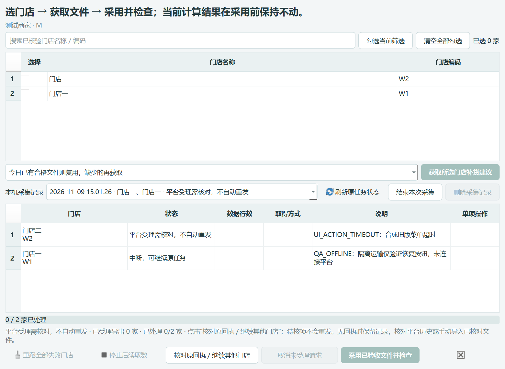

# 0.49.5 rc2 交付报告

本版修复翱象补货建议“全部信息导出”菜单点击超时后的恢复流程。原程序准备阶段悬停展开菜单，但跨IPC、意图落库及范围复核后直接点击；菜单在点击阶段不可见会超时。进入提交边界后统一保留为受理未知，而旧界面没有专用恢复路径。截图只证明菜单不可见，不能证明有弹窗，也不能单凭空任务号证明未提交。

## 已实现

- 提交前再次展开菜单，在同一同步步骤检查唯一、可见、可用及未被其他控件遮挡，再派发一次DOM点击，避免指针移入菜单过程导致菜单收起。不强制点击或自动重复写操作。
- 只有明确未派发点击且未观察到请求/回执时，原意图留为CANCELLED_BEFORE_SUBMIT，继续原run重新核验范围。派发期间断开、请求已发出、出现冲突回执等继续受理待核。
- 新增专用collection.continue。普通resume和retry仍不能重派待核记录。专用动作保留未知项，按原顺序继续其他等待门店；有可靠保存原任务号的项可沿原run恢复，成功文件保持。
- 不修改未知受理的结束/删除保护，不按最新任务、同数量或近似店名猜测认领。原保护回归断言保留，新增协议也拒绝force参数。
- 提示说明具体页面步骤；底层点击诊断去掉ANSI颜色控制码。HTML及Markdown新人手册增加操作补充，交付根目录附本版独立说明。原PDF仍标注0.49.3，不冒充全面更新。

## 使用

正常关闭旧程序，解压完整rc2目录后启动。在“获取翱象补货建议 → 本机采集记录”选择原批次，点“核对原回执 / 继续其他门店”。待核门店保持不重发，其他门店处理完后点“采用已验收文件并检查”。明确提示“本次未点击提交”的新失败，可点“继续原采集任务”。

旧版完全没有可靠回执的门店仍需核对平台历史及原件；空任务号、旧UI_ACTION_TIMEOUT和暂时查不到历史均不自动解除保护。可核实平台已有文件的门店与范围后下载，通过补货出单“添加文件”检查采用，不清除旧记录。跨日与账号范围校验保持。没有远程修改Administrator电脑上的原作业。

## 验证与已知限制

- 全量Python回归1335个独立测试通过，487.465秒；204项Node组件测试通过。
- 源码和实际EXE各5项Qt交互检查：待核恢复按钮可用、使用专用协议、未调用reserve/resume/retry重发、原未知项保持、其他门店状态更新、关闭假连接；其中界面检查按5组记录。rc2退出码0，主窗口正常关闭并等待共享拥有者释放。
- 包内真实模块3项隔离Edge测试通过：菜单在准备后收起，提交时重新展开并恰好一个请求；隐藏/禁用/遮挡不派发；派发后异常及已观察到请求均不降为未提交。所有网络由路由拦截返回合成数据，不访问真实平台。
- 15个受保护计算核心文件、153个旧交付EXE/ZIP文件哈希不变。模型0.3.4-rules、归属0.5.2、参数/作业/存储3/1/2保持。
- 未在真实翱象和出现故障的另一台电脑上验证，不宣称已自动修复其无回执旧记录。本版不包含独立0.49.4删除性能分支，也未实施上一轮独立诊断出的启动登录核验调整。

## 保留的失败证据

首次Python全量回归1335项有1项错误：子进程未继承src模块路径，ModuleNotFoundError。未放宽断言，补齐PYTHONPATH后重新完整跑，最终全量通过。首次日志保留在qa/export_recovery_0495_20261109/regression.log。

rc1 EXE的界面断言通过，但验收进程退出异常；独立exe1_repeat复现退出码3221226505（0xC0000409）。验收夹具改为子对话框归属主窗口、正常关闭并等待共享会话释放后延迟退出。重新固定源码构建rc2，通过完整进程验收。rc1目录标注“未通过验收_请勿分发”，失败日志和包保留，不算为通过结果。

## 交付与追溯

- 分支：fix/aoxiang-export-recovery-0.49.5；功能提交8dea2c4；最终固定构建提交2ab8dba22be3e51364a6d91b56c7674e1f5eb9c0。
- EXE：交付_0.49.5_rc2/补货助手/补货助手.exe，需使用完整目录。
- ZIP：交付_0.49.5_rc2/补货助手_0.49.5_rc2.zip。
- EXE SHA256：f1f3fbfea9b53608287c068207a4a26af37c1b74c198b6f4a54557dcc996f8af。
- ZIP SHA256：ad6eb43c276b2e18fddeb8082ce07232f43d79ba17c185b8d7ca5e1900d2b140。
- QA：qa/export_recovery_0495_20261109。工具verify_export_menu.py、verify_packaged_export_menu.py、seal_export_menu.py均已入库；输出目录必须新建。
- 旧交付保留，本轮未推送、未合并。

